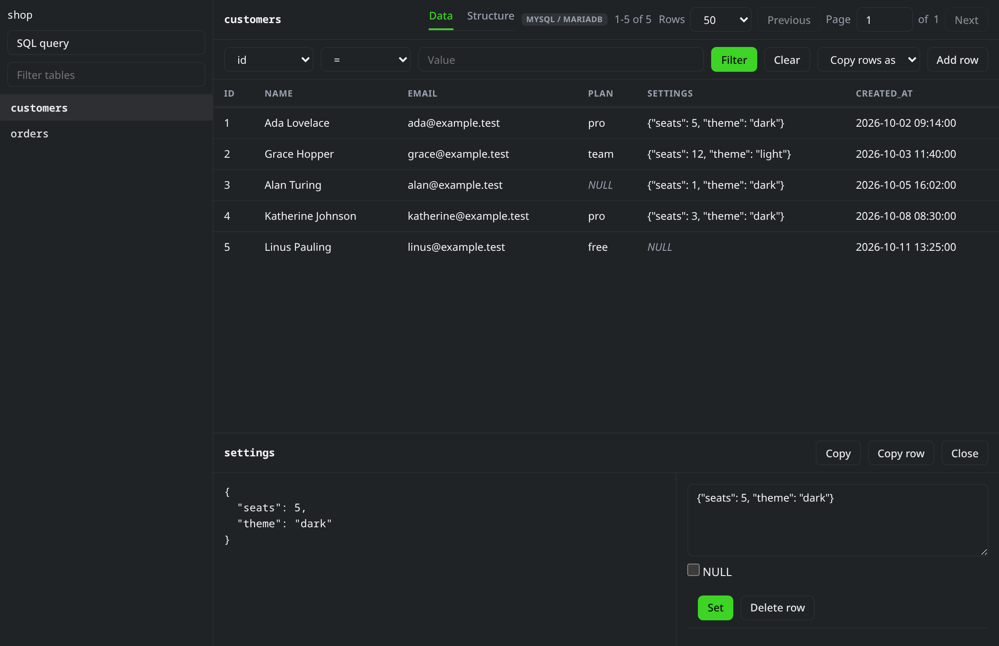

# Database browser

Adds a **Database** tab to every site that has a database (on lerd 1.38 the tab shows on every site and says when there is none). The left side lists the site's tables, picking one shows its rows a page at a time. Pick how many rows a page shows (50 to 1000, remembered for next time), and move with Previous and Next or type a page number.

Click a column header to sort by it, again for the other direction, and a third time to go back to the table's own order, which is its primary key so pages never shift. The filter bar under the toolbar narrows the rows on one column: equal, not equal, the comparisons, contains, starts with, or whether it is null. Click any cell to see its whole value in a panel under the rows, with JSON laid out, Copy for the value and Copy row for the whole row as JSON. **Copy rows as** copies the rows on the page as CSV, JSON or SQL INSERT statements. **Structure** next to **Data** lists the table's columns with their types, nullability, defaults and primary key, its indexes and its foreign keys.

Tables with a primary key can be edited. Double-click a cell to change it in place, Enter to keep the change and Escape to drop it, or use the panel a single click opens under the rows, which can also set a value to NULL or delete the row. **Add row** starts a new row on top; columns you leave alone take their defaults. Changes are only staged: the bar above the rows counts them, **Discard** drops them, and **Commit** shows the exact statements and runs them in one transaction, so either all of them land or none do. Moving to another page, table or database with changes staged asks first. Views and tables without a primary key are read only.

**SQL query** above the table list opens an editor for the open database. Type one statement and press Run or Ctrl+Enter. A read runs straight away and shows up to 1000 rows, as a table, JSON, aligned text or CSV, each with a Copy button; add your own LIMIT to choose which rows. A statement that can change the database, such as an INSERT, UPDATE, DELETE or anything that alters a table, asks before it runs and then says how many rows it changed. The editor keeps the site's last 50 queries under History.

When a site points at more than one database, such as a second connection string in its `.env`, the picker above the table list switches between them, and the tab remembers your pick for that site. It only ever offers the site's own databases, never another site's on the same server.

It works with MySQL, MariaDB and PostgreSQL through `lerd db:shell`, including external servers added with `lerd db:use`, and SQLite through PHP in the site's container.

The tab only works from the dashboard on this machine, not from another device on the LAN.

## Known limits

- The editor runs one statement at a time; put each on its own run.
- Copying covers the page on screen or a query result of up to 1000 rows. To export a whole database, use **Export** on lerd's Databases page or `lerd db:export`.
- MySQL and MariaDB print a null and the text `NULL` the same way, so both show as NULL.
- Opening the tab starts the site's database service if it was stopped.
- The tab shows the databases of the site's main folder, not of a worktree with its own database.
- On a lerd older than 1.39 the picker is not there and the tab opens the database `lerd db:shell` picks.
