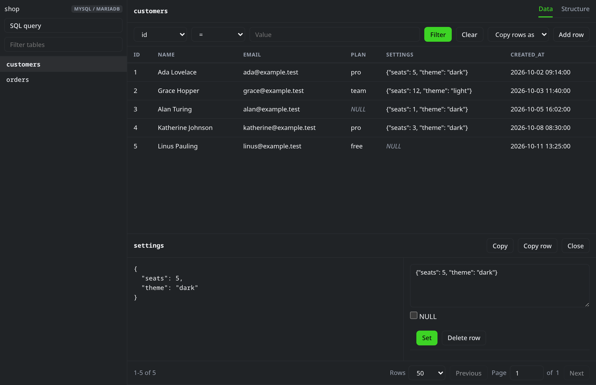
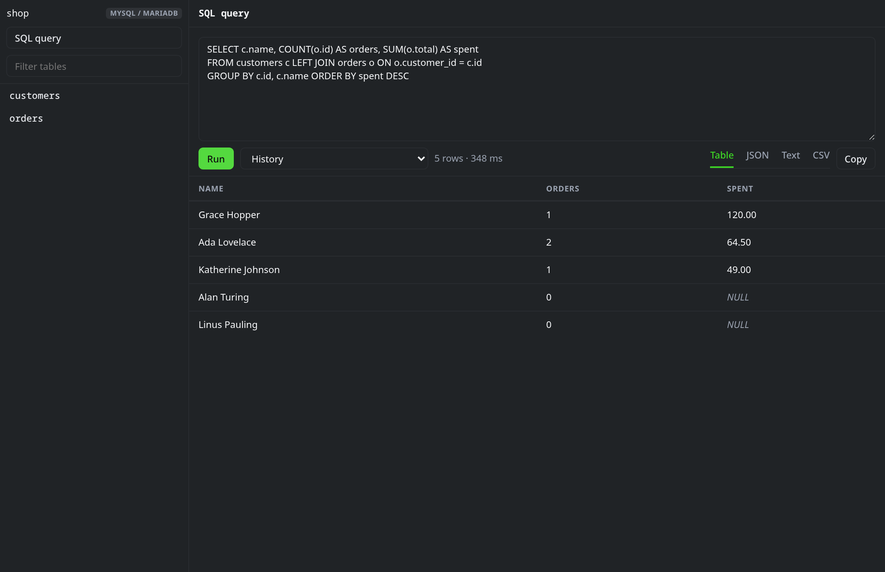
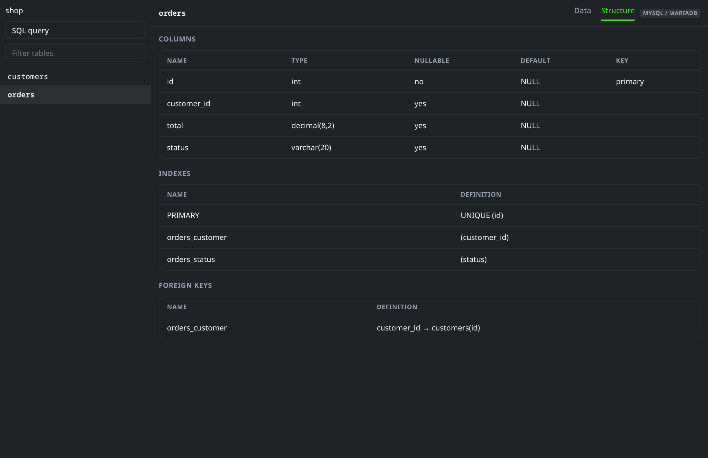

# Database browser for Lerd

> Browse, query and edit a [Lerd](https://lerd.sh) site's database on its own
> tab in the dashboard. MySQL, MariaDB, PostgreSQL or SQLite, with no client
> to install and no credentials to type.

[](LICENSE)
[](https://plugins.lerd.sh)
[](https://lerd.sh)
[](https://reddit.com/r/lerd)
[](https://discord.gg/5JK54s7xCC)



Looking at a site's data usually means opening a separate client and copying credentials out of its `.env`. This plugin puts the site's database in the dashboard instead: the tables on the left, the rows on the right, a SQL editor a click away, and edits that are shown before they run. Lerd already knows where each site's database is, so there is nothing to set up.

## Install

```bash
lerd plugin install db-browser
```

## Use

Open a site in the dashboard and pick the **Database** tab. It shows on every site that points at a database.



- **Browse:** pick a table to see its rows a page at a time, 50 to 1000 rows a page, remembered for next time. Click a column header to sort, and use the filter bar to narrow the rows on one column.
- **Inspect:** click a cell to open its whole value in a panel under the rows, with JSON laid out. **Copy rows as** copies the page as CSV, JSON or SQL INSERT statements.
- **Structure:** next to **Data**, lists the table's columns, indexes and foreign keys.
- **SQL query:** runs one statement at a time, with Run or Ctrl+Enter, and shows the result as a table, JSON, aligned text or CSV. It keeps the site's last 50 queries.
- **Edit:** double-click a cell to change it, or use the panel to set a value to NULL or delete the row; **Add row** starts a new one. Changes are staged until **Commit**, which shows the exact statements first.
- **Several databases:** a site that points at more than one gets a picker above the tables.

The full instructions are on the plugin's **Documentation** tab in the dashboard.



## What it does

- Opens MySQL, MariaDB and PostgreSQL through `lerd db:shell`, which knows the site's service and credentials, and SQLite through PHP in the site's container, so the machine needs no database client.
- Offers only the databases Lerd says the site points at, never another site's on the same server.
- Takes table and column names only from what the database lists, never as typed, and puts filter values into the SQL as escaped literals.
- Asks before running any typed statement that can change the database, and caps a typed read at 1000 rows unless it brings its own LIMIT.
- Edits only tables with a primary key, naming each row by its whole key, and commits a set of edits in one transaction, so either all of them land or none do.
- Talks UTF-8 to MySQL and MariaDB, whose clients in Lerd's containers default to latin1, so accented text reads and writes as it is.

## What it reads, changes and sends

It reads the site list and the database services from Lerd's API, and the site's `.env` only to find a SQLite file. It reads the database you browse, and writes to it only when you commit edits or confirm a statement that changes it. It keeps your page size, the database you picked on each site, the engine of each service and each site's last 50 queries in the plugin's data folder. The tab answers only the dashboard on this machine, not one opened from another device. Nothing leaves your machine.

## Requirements

- Lerd 1.38 or newer, and Node, which Lerd installs
- On Lerd 1.38 the tab shows on every site and opens the database `lerd db:shell` picks; showing it only on sites with a database, and the picker between a site's databases, need the next Lerd release

## Development

```bash
npm install
npm test
lerd plugin install .
```

The tests drive the endpoint against a stand-in for `lerd db:shell`, and the tab in a real browser against a stand-in for Lerd's API, so they need neither Lerd nor a database.

## License

MIT
